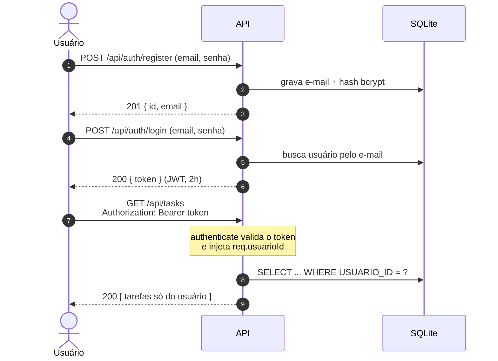
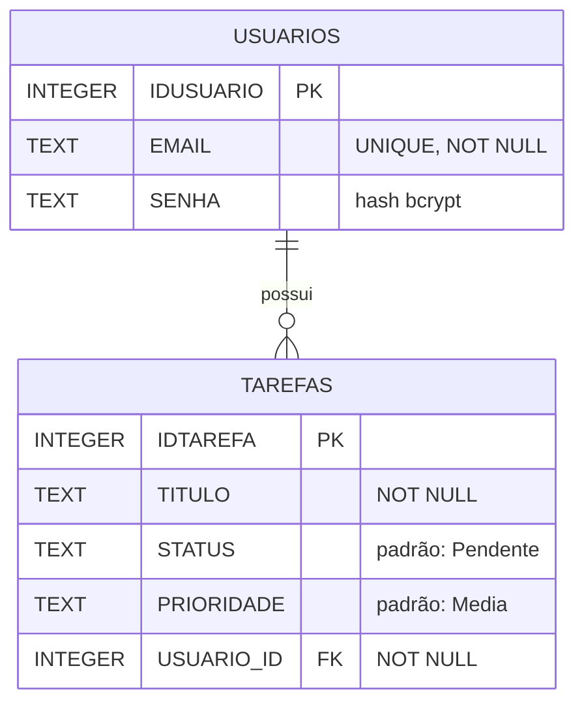

<div align="center">


[](https://git.io/typing-svg)


</div>

---

## 📖 Sobre

Projeto acadêmico (SENAI · Desenvolvimento de Sistemas Web) que evolui, aula a aula, de uma página HTML estática para uma **API REST multiusuário**: cadastro e login, rotas protegidas por token e tarefas isoladas por dono.

O repositório tem duas partes:

| Parte | Arquivo | Estado |
|---|---|---|
| ⚙️ **API** | [`server.ts`](server.ts) | Funcional: autenticação, CRUD de tarefas e isolamento por usuário |
| 🎨 **Interface** | [`index.html`](index.html) | Protótipo estático com Tailwind, **ainda não conectado à API** |

---

## ✨ Recursos

- 🔐 **Cadastro e login** com senha criptografada (`bcryptjs`) e token JWT válido por 2 horas
- 🛡️ **Rotas protegidas** por um middleware (`authenticate`) que barra requisições sem token válido
- 👥 **Isolamento por usuário**: toda consulta de tarefa filtra por `USUARIO_ID`, então ninguém lê, edita ou apaga a tarefa de outra pessoa
- ✅ **CRUD completo** de tarefas: `GET`, `POST`, `PUT`, `PATCH` e `DELETE`
- 🔎 **Busca por título** com `?search=`
- 🧱 **Validação centralizada**: helpers únicos para título, prioridade, status e ID
- 💉 **Proteção contra SQL Injection**: apenas *prepared statements*, nunca texto colado na query
- 🕵️ **Mensagens de erro genéricas**: o cliente nunca vê a estrutura do banco
- ⏱️ **Login resistente a *timing attack***: a senha é comparada com um hash mesmo quando o e-mail não existe

---

## 🚀 Como rodar

**Pré-requisito:** Node.js instalado.

```bash
# 1. Clone o repositório
git clone https://github.com/BlankSenai/DSW-repo.git
cd DSW-repo

# 2. Instale as dependências
npm install

# 3. Suba o servidor (com recarga automática)
npm run dev
```

O servidor sobe em **http://localhost:3000** e cria o arquivo `tarefas.db` na primeira execução.

### 🧰 Scripts

| Comando | O que faz |
|---|---|
| `npm run dev` | Inicia com `tsx watch` (reinicia ao salvar) |
| `npm start` | Inicia uma vez com `tsx` |
| `npm run build` | Roda o `tsc` apenas para checar tipos (`noEmit`, não gera arquivos) |

### 🔧 Variáveis de ambiente

| Variável | Padrão | Descrição |
|---|---|---|
| `PORT` | `3000` | Porta do servidor |
| `JWT_SECRET` | valor fixo no código | Segredo usado para assinar os tokens |

> [!WARNING]
> O `JWT_SECRET` padrão está escrito no código e serve apenas para estudo. Em qualquer ambiente real, defina o seu próprio: `JWT_SECRET="algo-longo-e-aleatorio" npm start`.

---

## 🔑 Fluxo de autenticação



---

## 📡 Endpoints

Base: `http://localhost:3000/api` · 🔒 = exige o cabeçalho `Authorization: Bearer <token>`

### Públicos

| Método | Rota | Descrição | Respostas |
|---|---|---|---|
| `GET` | `/health` | Integridade do sistema | `200` |
| `GET` | `/version` | Nome e versão da aplicação | `200` |
| `POST` | `/auth/register` | Cadastra usuário | `201` · `400` dados inválidos · `409` e-mail já cadastrado |
| `POST` | `/auth/login` | Autentica e devolve o token | `200` · `400` · `401` credenciais inválidas |

### Tarefas 🔒

| Método | Rota | Descrição | Respostas |
|---|---|---|---|
| `GET` | `/tasks` | Lista as tarefas do usuário (aceita `?search=`) | `200` · `401` |
| `POST` | `/tasks` | Cria uma tarefa | `201` · `400` · `401` |
| `PUT` | `/tasks/:id` | Atualização completa | `200` · `400` · `401` · `404` |
| `PATCH` | `/tasks/:id` | Atualização parcial | `200` · `400` · `401` · `404` |
| `DELETE` | `/tasks/:id` | Exclui a tarefa | `200` · `400` · `401` · `404` |

> Tarefa inexistente **ou** que pertence a outro usuário responde `404`, sem revelar qual das duas.

<details>
<summary><b>📥 Exemplos de corpo e resposta</b></summary>

<br>

**Cadastro**
```http
POST /api/auth/register
Content-Type: application/json

{ "email": "aluno@senai.com", "senha": "minhaSenhaSegura123" }
```
```json
{ "id": 2, "email": "aluno@senai.com" }
```

**Login**
```http
POST /api/auth/login
Content-Type: application/json

{ "email": "aluno@senai.com", "senha": "minhaSenhaSegura123" }
```
```json
{ "token": "eyJhbGciOiJIUzI1NiIsInR5cCI6IkpXVCJ9..." }
```

**Criar tarefa**
```http
POST /api/tasks
Content-Type: application/json
Authorization: Bearer <token>

{ "title": "Estudar Node.js e SQLite", "prioridade": "Alta" }
```
```json
{
  "IDTAREFA": 1,
  "TITULO": "Estudar Node.js e SQLite",
  "STATUS": "Pendente",
  "PRIORIDADE": "Alta",
  "USUARIO_ID": 2
}
```

**Atualização parcial**
```http
PATCH /api/tasks/1
Content-Type: application/json
Authorization: Bearer <token>

{ "status": "Finalizada" }
```

</details>

### 📏 Regras de validação

| Campo | Regra |
|---|---|
| `email` | Texto; vira o identificador único do usuário |
| `senha` | Texto com pelo menos 6 caracteres |
| `title` | Texto com pelo menos 3 caracteres (espaços nas pontas são removidos) |
| `prioridade` | `Baixa`, `Media` ou `Alta` |
| `status` | `Pendente` ou `Finalizada` |
| `:id` | Número inteiro |

**`POST` e `PUT` são tolerantes**: `prioridade` e `status` ausentes ou inválidos voltam ao padrão (`Media` e `Pendente`). No `PUT`, isso significa que omitir o `status` reabre a tarefa. **`PATCH` é estrito**: valor inválido devolve `400`.

---

## 🗄️ Banco de dados

SQLite em arquivo (`tarefas.db`, ignorado pelo Git), acessado com `better-sqlite3`.



> [!NOTE]
> Ao subir, o servidor confere se a tabela `TAREFAS` já tem a coluna `USUARIO_ID`. Se for uma versão antiga do banco (sem dono), a tabela é **descartada e recriada**, e as tarefas antigas se perdem. Para zerar tudo manualmente, apague o `tarefas.db` e reinicie.

---

## 🧪 Testando

O arquivo [`requests.http`](requests.http) reúne os cenários de teste de cada aula. Abra no VS Code com a extensão [REST Client](https://marketplace.visualstudio.com/items?itemName=humao.rest-client) e clique em **Send Request**.

1. Rode o **teste 35** (cadastro) e o **38** (login). O token da resposta fica guardado automaticamente na variável `{{token}}`.
2. Rode as demais requisições. As rotas de tarefas já enviam `Authorization: Bearer {{token}}`.
3. Veja a seção **"Rotas Protegidas e Isolamento por Usuário"** (testes 40 a 49): sem token, token inválido e um segundo usuário tentando mexer nas tarefas do primeiro.

---

## 🎨 Interface (protótipo)

[`index.html`](index.html) é uma página estática feita com HTML5 semântico e **Tailwind CSS v4** (via CDN no navegador). Tem formulário de acesso, formulário de criação de tarefa e cartões com etiquetas coloridas por prioridade, em layout responsivo. Ela **não faz chamadas à API ainda**: os dados são fixos no HTML.

Para visualizar, abra o `index.html` no navegador ou use **Open with Five Server** no VS Code.

---

## 🗂️ Estrutura

```text
DSW-repo/
├── server.ts        # API: rotas, middleware, validações e banco
├── index.html       # Protótipo da interface (Tailwind)
├── requests.http    # Cenários de teste das rotas
├── diario/          # Notas semanais de aprendizado
├── package.json
└── tsconfig.json
```

---

## ⚠️ Limitações conhecidas

- O usuário `admin@senai.com` criado no início guarda a senha em **texto puro** (de propósito, como dado de exemplo para estudo de vazamento). Como o login compara com hash, **esse usuário não consegue logar**.
- Não há *rate limiting*, então o login não tem proteção contra força bruta.
- A interface ainda não consome a API.

---

<div align="center">

Feito com ☕ e TypeScript por [BlankSenai](https://github.com/BlankSenai)


</div>
