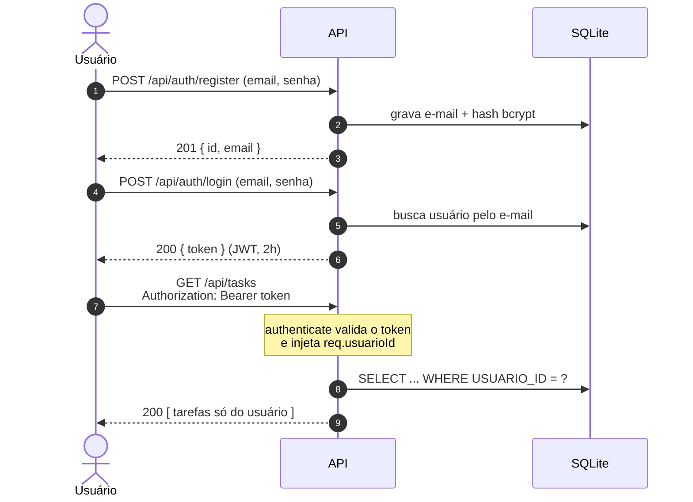
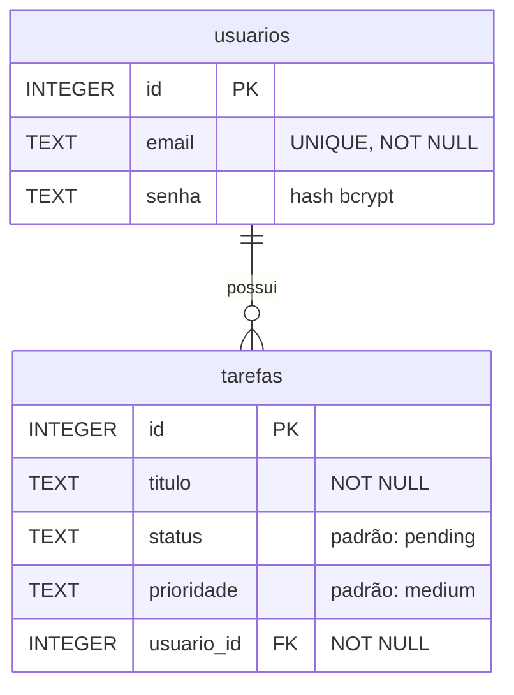

<div align="center">


[](https://git.io/typing-svg)


</div>

---

## 📖 Sobre

Projeto acadêmico (SENAI · Desenvolvimento de Sistemas Web) que evolui, aula a aula, de uma página HTML estática para uma **API REST multiusuário com interface em React**: cadastro e login, rotas protegidas por token e tarefas isoladas por dono.

O repositório tem três partes:

| Parte | Arquivo | Estado |
|---|---|---|
| ⚙️ **API** | [`server.ts`](server.ts) | Funcional: autenticação, CRUD de tarefas e isolamento por usuário |
| 🎨 **Interface** | [`web/`](web) | React + Vite + TypeScript + Tailwind, **conectada à API**: login, cadastro e CRUD de tarefas |
| 🧪 **Protótipo antigo** | [`index.html`](index.html) | Página estática da primeira fase, sem chamadas à API |

---

## ✨ Recursos

- 🔐 **Cadastro e login** com senha criptografada (`bcryptjs`) e token JWT válido por 2 horas
- 🛡️ **Rotas protegidas** por um middleware (`authenticate`) que barra requisições sem token válido
- 👥 **Isolamento por usuário**: toda consulta de tarefa filtra por `USUARIO_ID`, então ninguém lê, edita ou apaga a tarefa de outra pessoa
- ✅ **CRUD completo** de tarefas: `GET`, `POST`, `PUT`, `PATCH` e `DELETE`
- 🔎 **Busca por título** com `?search=`
- 🖥️ **Login e cadastro na interface**, com a sessão guardada no navegador (o token sobrevive ao `F5` e some ao clicar em **Sair**)
- ⌨️ **Busca com debounce**: a lista filtra 400 ms depois de a pessoa parar de digitar, sem uma requisição por tecla
- ♿ **Modal de exclusão acessível**: o foco vai para o botão de confirmar, `Esc` fecha e o leitor de tela anuncia o diálogo
- 🧱 **Validação centralizada**: helpers únicos para título, prioridade, status e ID
- 💉 **Proteção contra SQL Injection**: apenas *prepared statements*, nunca texto colado na query
- 🕵️ **Mensagens de erro genéricas**: o cliente nunca vê a estrutura do banco
- ⏱️ **Login resistente a *timing attack***: a senha é comparada com um hash mesmo quando o e-mail não existe

---

## 🚀 Como rodar

**Pré-requisito:** Node.js instalado.

```bash
# 1. Clone o repositório
git clone https://github.com/BlankSenai/DSW-repo.git
cd DSW-repo

# 2. Instale as dependências (API na raiz, interface em web/)
npm install
cd web && npm install && cd ..

# 3. Terminal 1: suba a API (com recarga automática)
npm run dev

# 4. Terminal 2: suba a interface
cd web
npm run dev
```

A API sobe em **http://localhost:3000** e cria o arquivo `tarefas.db` na primeira execução. A interface sobe em **http://localhost:5173**: o Vite encaminha tudo que começa com `/api` para a API (proxy em [`web/vite.config.ts`](web/vite.config.ts)), então o navegador só fala com um endereço.

> [!TIP]
> Para entrar na interface, crie uma conta em **Registre-se**. O `admin@senai.com` não consegue logar (veja *Limitações conhecidas*, no fim deste README).

### 🧰 Scripts

**API (raiz)**

| Comando | O que faz |
|---|---|
| `npm run dev` | Inicia com `tsx watch` (reinicia ao salvar) |
| `npm start` | Inicia uma vez com `tsx` |
| `npm run build` | Roda o `tsc` apenas para checar tipos (`noEmit`, não gera arquivos) |

**Interface (`web/`)**

| Comando | O que faz |
|---|---|
| `npm run dev` | Inicia o Vite com recarga automática |
| `npm run build` | Checa os tipos (`tsc -b`) e gera a pasta `dist/` |
| `npm run lint` | Roda o ESLint |

### 🔧 Variáveis de ambiente

| Variável | Padrão | Descrição |
|---|---|---|
| `PORT` | `3000` | Porta do servidor |
| `JWT_SECRET` | valor fixo no código | Segredo usado para assinar os tokens |

> [!WARNING]
> O `JWT_SECRET` padrão está escrito no código e serve apenas para estudo. Em qualquer ambiente real, defina o seu próprio: `JWT_SECRET="algo-longo-e-aleatorio" npm start`.

---

## 🔑 Fluxo de autenticação



Na interface, [`web/src/api.ts`](web/src/api.ts) guarda o token no `localStorage` (chave `gestor:token`) e o envia em todo pedido de tarefas. Ele só é **decodificado** para mostrar o e-mail na tela: quem valida a assinatura é a API.

---

## 📡 Endpoints

Base: `http://localhost:3000/api` · 🔒 = exige o cabeçalho `Authorization: Bearer <token>`

### Públicos

| Método | Rota | Descrição | Respostas |
|---|---|---|---|
| `GET` | `/health` | Integridade do sistema | `200` |
| `GET` | `/version` | Nome e versão da aplicação | `200` |
| `POST` | `/auth/register` | Cadastra usuário | `201` · `400` dados inválidos · `409` e-mail já cadastrado |
| `POST` | `/auth/login` | Autentica e devolve o token | `200` · `400` · `401` credenciais inválidas |

### Tarefas 🔒

| Método | Rota | Descrição | Respostas |
|---|---|---|---|
| `GET` | `/tasks` | Lista as tarefas do usuário (aceita `?search=`) | `200` · `401` |
| `POST` | `/tasks` | Cria uma tarefa | `201` · `400` · `401` |
| `PUT` | `/tasks/:id` | Atualização completa | `200` · `400` · `401` · `404` |
| `PATCH` | `/tasks/:id` | Atualização parcial | `200` · `400` · `401` · `404` |
| `DELETE` | `/tasks/:id` | Exclui a tarefa | `200` · `400` · `401` · `404` |

> Tarefa inexistente **ou** que pertence a outro usuário responde `404`, sem revelar qual das duas.

<details>
<summary><b>📥 Exemplos de corpo e resposta</b></summary>

<br>

**Cadastro**
```http
POST /api/auth/register
Content-Type: application/json

{ "email": "aluno@senai.com", "senha": "minhaSenhaSegura123" }
```
```json
{ "id": 2, "email": "aluno@senai.com" }
```

**Login**
```http
POST /api/auth/login
Content-Type: application/json

{ "email": "aluno@senai.com", "senha": "minhaSenhaSegura123" }
```
```json
{ "token": "eyJhbGciOiJIUzI1NiIsInR5cCI6IkpXVCJ9..." }
```

**Criar tarefa**
```http
POST /api/tasks
Content-Type: application/json
Authorization: Bearer <token>

{ "titulo": "Estudar Node.js e SQLite", "prioridade": "high" }
```
```json
{
  "id": 1,
  "titulo": "Estudar Node.js e SQLite",
  "status": "pending",
  "prioridade": "high",
  "usuario_id": 2
}
```

**Atualização parcial**
```http
PATCH /api/tasks/1
Content-Type: application/json
Authorization: Bearer <token>

{ "status": "completed" }
```

</details>

### 📏 Regras de validação

| Campo | Regra |
|---|---|
| `email` | Texto; vira o identificador único do usuário |
| `senha` | Texto com pelo menos 6 caracteres |
| `titulo` | Texto com pelo menos 3 caracteres (espaços nas pontas são removidos) |
| `prioridade` | `low`, `medium` ou `high` |
| `status` | `pending` ou `completed` |
| `:id` | Número (texto não numérico devolve `400`) |

**`POST` e `PUT` são tolerantes**: `prioridade` e `status` ausentes ou inválidos voltam ao padrão (`medium` e `pending`). No `PUT`, isso significa que omitir o `status` reabre a tarefa. **`PATCH` é estrito**: valor inválido devolve `400`.

> [!NOTE]
> Os valores trafegam sempre em inglês. A interface é que traduz para **Baixa**, **Média** e **Alta** só na hora de exibir.

---

## 🗄️ Banco de dados

SQLite em arquivo (`tarefas.db`, ignorado pelo Git), acessado com `better-sqlite3`.



> [!NOTE]
> O servidor cria as tabelas na primeira execução e **não migra** um banco antigo. Se você tem um `tarefas.db` de uma versão anterior (colunas como `IDTAREFA`, valores como `Pendente`), a API não sobe: apague o arquivo e reinicie. As tarefas antigas se perdem.

---

## 🧪 Testando

O arquivo [`request.http`](request.http) reúne os cenários de teste da API. Abra no VS Code com a extensão [REST Client](https://marketplace.visualstudio.com/items?itemName=humao.rest-client) e clique em **Send Request**.

1. Rode o **teste 35** (cadastro) e o **38** (login). O token da resposta fica guardado automaticamente na variável `{{token}}`.
2. Rode as demais requisições, em ordem. As rotas de tarefas já enviam `Authorization: Bearer {{token}}`. O token vale 2 horas: se der `401`, rode o 38 de novo.
3. O **teste 40B** confirma que, sem token, a API responde `401`.

> [!NOTE]
> Os testes usam IDs fixos (`/tasks/1`, `/tasks/2`). Para os resultados baterem com os títulos, rode em ordem num `tarefas.db` novo (apague o arquivo e reinicie a API).

Para testar a interface, suba os dois servidores e siga o fluxo: criar conta, adicionar tarefas com prioridades diferentes, concluir e reabrir, buscar por título, excluir pelo modal, **Sair** e recarregar a página.

---

## 🎨 Interface

A pasta [`web/`](web) é um app **React 19 + TypeScript** com **Vite** e **Tailwind CSS v4** (tema escuro) que consome a API:

| Arquivo | Papel |
|---|---|
| [`web/src/api.ts`](web/src/api.ts) | Único lugar que conhece a API: tipos, token (JWT) e as chamadas de login, cadastro e CRUD |
| [`web/src/App.tsx`](web/src/App.tsx) | Decide a tela: sem usuário mostra o login, com usuário mostra as tarefas. É o dono da sessão |
| [`web/src/Login.tsx`](web/src/Login.tsx) | Tela de entrada e de cadastro |
| [`web/src/Tarefas.tsx`](web/src/Tarefas.tsx) | Lista, cria, conclui e exclui tarefas, com busca e modal de confirmação |

Dois cuidados da tela de tarefas:

- **Dois estados para a busca**: um guarda o que está na caixa de texto e outro o que vai para a API, com debounce entre os dois.
- **Respostas fora de ordem são descartadas**: uma busca antiga não sobrescreve a mais recente.

> [!NOTE]
> O [`index.html`](index.html) da raiz é o protótipo estático da primeira fase (Tailwind via CDN, dados fixos no HTML). Ele não faz parte do app e não chama a API.

---

## 🗂️ Estrutura

```text
DSW-repo/
├── server.ts        # API: rotas, middleware, validações e banco
├── web/             # Interface React (Vite + TypeScript + Tailwind)
│   └── src/         # api.ts, App.tsx, Login.tsx e Tarefas.tsx
├── meu-primeiro-app/ # Exercício de React das aulas iniciais (lista em memória)
├── index.html       # Protótipo estático da primeira fase
├── request.http     # Cenários de teste das rotas
├── diario/          # Notas semanais de aprendizado
├── package.json
└── tsconfig.json
```

---

## ⚠️ Limitações conhecidas

- O usuário `admin@senai.com` criado no início guarda a senha em **texto puro** (de propósito, como dado de exemplo para estudo de vazamento). Como o login compara com hash, **esse usuário não consegue logar**: para usar a interface, crie uma conta em **Registre-se**.
- Não há *rate limiting*, então o login não tem proteção contra força bruta.
- API e interface rodam em endereços separados (`3000` e `5173`), ligados pelo proxy do Vite: são dois terminais.

---

<div align="center">

Feito com ☕ e TypeScript por [BlankSenai](https://github.com/BlankSenai)


</div>
