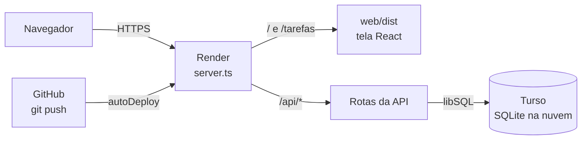
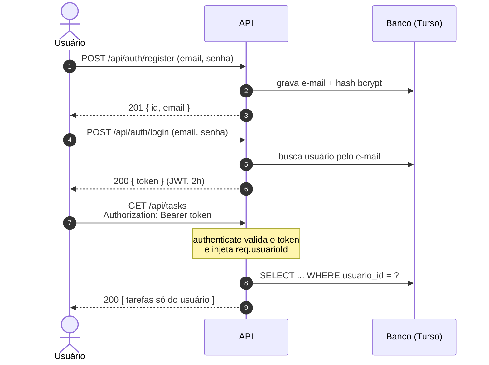
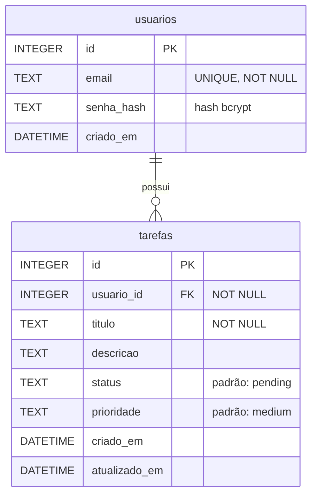

<div align="center">


[](https://git.io/typing-svg)


### 🌐 [Acessar a aplicação no ar](https://gerenciador-de-tarefas-bci8.onrender.com)

</div>

---

## 📖 Sobre

Projeto acadêmico (SENAI · Desenvolvimento de Sistemas Web) que evolui, aula a aula, de uma página HTML estática para uma **aplicação web multiusuário publicada na internet**: API REST com cadastro, login e tarefas isoladas por dono, interface em React, banco SQLite na nuvem (Turso) e deploy no Render.

| Parte | Onde | O que faz |
|---|---|---|
| ⚙️ **API** | [`server.ts`](server.ts) | Autenticação, CRUD de tarefas, isolamento por usuário **e** entrega da tela (o build do React) |
| 🎨 **Interface** | [`web/`](web) | React + Vite + TypeScript + Tailwind: login, cadastro e CRUD de tarefas |
| 🗄️ **Banco** | Turso (nuvem) ou `tarefas.db` (local) | O mesmo SQLite, acessado com `@libsql/client` |
| ☁️ **Deploy** | [`render.yaml`](render.yaml) | Um único Web Service no Render entrega API e tela no mesmo endereço |
| 🧪 **Legado** | [`legado/`](legado) | Protótipo HTML estático e o primeiro app React das aulas iniciais |

---

## ✨ Recursos

**Segurança e API**
- 🔐 **Cadastro e login** com senha criptografada (`bcryptjs`) e token JWT válido por 2 horas
- 🛡️ **Rotas protegidas** por um middleware (`authenticate`) que barra requisições sem token válido
- 👥 **Isolamento por usuário**: toda consulta de tarefa filtra por `usuario_id`, então ninguém lê, edita ou apaga a tarefa de outra pessoa
- ✅ **CRUD completo** de tarefas (`GET`, `POST`, `PUT`, `PATCH`, `DELETE`) com busca por título (`?search=`)
- 💉 **Proteção contra SQL Injection**: os valores vão sempre como parâmetros (`?` + `args`), nunca colados na query
- ⏱️ **Login resistente a *timing attack***: mesmo com e-mail inexistente, a senha é comparada com um hash bcrypt de verdade, e a resposta leva o mesmo tempo
- 🕵️ **Mensagens de erro genéricas** e status corretos: `409` só para e-mail repetido, `500` quando o banco falha (e não "senha errada")

**Banco na nuvem**
- ☁️ **Turso / libSQL**: com `TURSO_URL` e `TURSO_TOKEN`, os dados vivem na nuvem e sobrevivem aos deploys; sem eles, a API usa o arquivo local `tarefas.db`
- 📋 **Banner na inicialização** dizendo onde os dados estão sendo gravados
- 🧷 **Defesas de inicialização**: aviso de `.env` salvo com BOM, erro claro para URL/token inválidos e para banco de versão antiga
- 🩺 **Diagnóstico**: `/api/health` consulta o banco de verdade e `/api/db-check` lista tabelas e contagens

**Interface**
- 🖥️ **Front servido pelo próprio Express**: uma porta só, sem CORS, com *SPA fallback* (o F5 em `/tarefas` não dá 404)
- 💾 **Sessão no navegador**: o token sobrevive ao `F5` e some ao clicar em **Sair**
- ⌨️ **Busca com debounce**: a lista filtra 400 ms depois de a pessoa parar de digitar, descartando respostas fora de ordem
- 🏷️ **Filtro por prioridade** (Todas, Baixa, Média, Alta), feito no próprio navegador, sem nova chamada à API
- ♿ **Modal de exclusão acessível**: foco no botão de confirmar, `Esc` fecha e o leitor de tela anuncia o diálogo

---

## 🚀 Como rodar

**Pré-requisito:** Node.js **20.12 ou superior** (`node --version`).

```bash
# 1. Clone o repositório
git clone https://github.com/BlankSenai/DSW-repo.git
cd DSW-repo

# 2. Instale as dependências (API na raiz, interface em web/)
npm install
npm --prefix web install
```

**3. (Opcional) Banco na nuvem:** copie o [`.env.example`](.env.example) para `.env` e preencha com os dados do seu banco no Turso. Sem o `.env`, tudo funciona com o arquivo local `tarefas.db`.

Depois, escolha um dos dois modos:

| | 🛠️ Modo desenvolvimento | 📦 Modo servido pelo back |
|---|---|---|
| **Para quê** | Editar código (recarrega ao salvar) | Ver como fica em produção |
| **Comandos** | Terminal 1: `npm run dev`<br>Terminal 2: `npm run dev:web` | `npm run build:web`<br>`npm run dev` |
| **Abrir** | http://localhost:5173 | http://localhost:3000 |
| **Como a tela fala com a API** | Proxy do Vite encaminha `/api` para a porta 3000 | Mesma origem: o Express entrega tela e API |

> [!TIP]
> Para entrar, use o usuário de laboratório **`admin@senai.com`** / **`senha_super_secreta_123`** (criado automaticamente na primeira execução) ou crie uma conta em **Registre-se**.

> [!WARNING]
> No modo servido pelo back, o navegador mostra o **build**, não os fontes. Se você mudou algo em `web/src`, rode `npm run build:web` de novo: o servidor avisa no terminal quando o build está velho.

### 🧰 Scripts

**Raiz**

| Comando | O que faz |
|---|---|
| `npm run dev` | Inicia a API com `tsx watch` (reinicia ao salvar) |
| `npm start` | Inicia a API uma vez com `tsx` (é o que o Render usa) |
| `npm run build` | Build completo: instala o `web/`, gera o `web/dist` e checa os tipos do back (`tsc`) |
| `npm run build:web` | Só o build da interface (gera `web/dist`) |
| `npm run dev:web` | Só a interface em modo desenvolvimento (Vite) |

**Interface (`web/`)**

| Comando | O que faz |
|---|---|
| `npm run dev` | Inicia o Vite com recarga automática |
| `npm run build` | Checa os tipos (`tsc -b`) e gera a pasta `dist/` |
| `npm run lint` | Roda o ESLint |

### 🔧 Variáveis de ambiente

Lidas do arquivo `.env` na raiz (modelo em [`.env.example`](.env.example)) ou do ambiente do sistema, que tem prioridade.

| Variável | Padrão | Descrição |
|---|---|---|
| `TURSO_URL` | — | Endereço do banco no Turso (`libsql://...`, sem barra no final) |
| `TURSO_TOKEN` | — | Token de acesso ao banco do Turso |
| `JWT_SECRET` | valor fixo no código | Segredo que assina os tokens de login |
| `PORT` | `3000` | Porta do servidor |

> [!WARNING]
> O `.env` **nunca** vai para o Git (está no `.gitignore`). Salve-o em **UTF-8 sem BOM**: com BOM, a primeira variável é ignorada sem erro (o servidor avisa no terminal). E o `JWT_SECRET` padrão serve apenas para estudo.

---

## ☁️ Deploy (Render + Turso)

A aplicação está no ar em **https://gerenciador-de-tarefas-bci8.onrender.com**.



Por que o banco precisa estar fora: no Render o disco é **efêmero**, apagado a cada deploy ou reinício. Um `tarefas.db` local perderia todos os usuários e tarefas.

O [`render.yaml`](render.yaml) descreve o serviço (infraestrutura como código):

| Configuração | Valor |
|---|---|
| Build | `npm install && npm run build` |
| Start | `npm start` |
| Health check | `/api/health` (só responde 200 se o banco responder) |
| `JWT_SECRET` | Gerado pelo Render no primeiro deploy |
| `TURSO_URL` / `TURSO_TOKEN` | Preenchidos à mão no painel |
| Auto deploy | Cada `git push` na `main` publica uma nova versão |

**Para publicar a sua cópia:** no Render, **New + → Blueprint**, conecte o repositório e informe `TURSO_URL` e `TURSO_TOKEN`. Depois confira `/api/health` (deve mostrar `"banco": "Turso / libSQL (nuvem)"`) e `/api/db-check`.

---

## 🔑 Fluxo de autenticação



Na interface, [`web/src/api.ts`](web/src/api.ts) guarda o token no `localStorage` (chave `gestor:token`) e o envia em todo pedido de tarefas. Ele só é **decodificado** para mostrar o e-mail na tela: quem valida a assinatura é a API.

---

## 📡 Endpoints

Base: `/api` (local: `http://localhost:3000/api`) · 🔒 = exige o cabeçalho `Authorization: Bearer <token>`

### Públicos

| Método | Rota | Descrição | Respostas |
|---|---|---|---|
| `GET` | `/health` | Servidor e banco no ar (informa o modo do banco) | `200` · `503` banco sem resposta |
| `GET` | `/version` | Nome e versão da aplicação | `200` |
| `GET` | `/db-check` | Tabelas do banco e quantidade de registros em cada uma | `200` · `503` |
| `POST` | `/auth/register` | Cadastra usuário | `201` · `400` dados inválidos · `409` e-mail já cadastrado · `500` |
| `POST` | `/auth/login` | Autentica e devolve o token | `200` · `400` · `401` credenciais inválidas · `500` |

### Tarefas 🔒

| Método | Rota | Descrição | Respostas |
|---|---|---|---|
| `GET` | `/tasks` | Lista as tarefas do usuário (aceita `?search=`) | `200` · `401` |
| `POST` | `/tasks` | Cria uma tarefa | `201` · `400` · `401` |
| `PUT` | `/tasks/:id` | Atualização completa | `200` · `400` · `401` · `404` |
| `PATCH` | `/tasks/:id` | Atualização parcial | `200` · `400` · `401` · `404` |
| `DELETE` | `/tasks/:id` | Exclui a tarefa | `200` · `400` · `401` · `404` |

> Tarefa inexistente **ou** que pertence a outro usuário responde `404`, sem revelar qual das duas.

### Fora da API

| Caminho | Resposta |
|---|---|
| `/api/qualquer-coisa-inexistente` | `404` em JSON (nunca HTML) |
| Arquivos do build (`/favicon.svg`, `/assets/...`) | O arquivo, com o Content-Type certo |
| Qualquer outro caminho (`/`, `/tarefas`...) | O `index.html` do React (*SPA fallback*) |

<details>
<summary><b>📥 Exemplos de corpo e resposta</b></summary>

<br>

**Cadastro**
```http
POST /api/auth/register
Content-Type: application/json

{ "email": "aluno@senai.com", "senha": "minhaSenhaSegura123" }
```
```json
{ "id": 2, "email": "aluno@senai.com" }
```

**Login**
```http
POST /api/auth/login
Content-Type: application/json

{ "email": "aluno@senai.com", "senha": "minhaSenhaSegura123" }
```
```json
{ "token": "eyJhbGciOiJIUzI1NiIsInR5cCI6IkpXVCJ9..." }
```

**Criar tarefa**
```http
POST /api/tasks
Content-Type: application/json
Authorization: Bearer <token>

{ "titulo": "Estudar Node.js e SQLite", "prioridade": "high" }
```
```json
{
  "id": 1,
  "usuario_id": 2,
  "titulo": "Estudar Node.js e SQLite",
  "descricao": null,
  "status": "pending",
  "prioridade": "high",
  "criado_em": "2026-11-24 23:55:45",
  "atualizado_em": "2026-11-24 23:55:45"
}
```

**Atualização parcial**
```http
PATCH /api/tasks/1
Content-Type: application/json
Authorization: Bearer <token>

{ "status": "completed" }
```

**Diagnóstico do banco**
```json
{
  "ok": true,
  "banco": "Turso / libSQL (nuvem)",
  "tabelas": ["tarefas", "usuarios"],
  "contagem": { "tarefas": 3, "usuarios": 2 }
}
```

</details>

### 📏 Regras de validação

| Campo | Regra |
|---|---|
| `email` | Texto com `@`; vira o identificador único do usuário |
| `senha` | Texto com pelo menos 6 caracteres |
| `titulo` | Texto com pelo menos 3 caracteres (espaços nas pontas são removidos) |
| `prioridade` | `low`, `medium` ou `high` |
| `status` | `pending` ou `completed` |
| `:id` | Número inteiro (texto não numérico devolve `400`) |

**`POST` e `PUT` são tolerantes**: `prioridade` e `status` ausentes ou inválidos voltam ao padrão (`medium` e `pending`). No `PUT`, isso significa que omitir o `status` reabre a tarefa. **`PATCH` é estrito**: valor inválido devolve `400` e nada é gravado.

> [!NOTE]
> Os valores trafegam sempre em inglês. A interface é que traduz para **Baixa**, **Média** e **Alta** só na hora de exibir.

---

## 🗄️ Banco de dados

SQLite acessado com [`@libsql/client`](https://github.com/tursodatabase/libsql-client-ts): no **Turso** quando há `TURSO_URL` e `TURSO_TOKEN`, ou no arquivo local `tarefas.db` (ignorado pelo Git) quando não há.



O servidor cria as tabelas na primeira execução (com `db.batch()`, que roda os dois `CREATE TABLE` de forma atômica) e só abre a porta depois que o banco está pronto.

> [!NOTE]
> As tabelas **não são migradas** de versões anteriores. Se você tem um `tarefas.db` antigo (coluna `senha` em vez de `senha_hash`), o servidor para na inicialização dizendo o que fazer: apague o arquivo e reinicie. Os dados antigos se perdem.

---

## 🧪 Testando

O arquivo [`request.http`](request.http) reúne os cenários de teste. Abra no VS Code com a extensão [REST Client](https://marketplace.visualstudio.com/items?itemName=humao.rest-client) e clique em **Send Request**.

1. Rode o **teste 35** (cadastro) e o **38** (login). O token da resposta fica guardado automaticamente na variável `{{token}}`.
2. Rode as demais requisições, em ordem. As rotas de tarefas já enviam `Authorization: Bearer {{token}}`. O token vale 2 horas: se der `401`, rode o 38 de novo.
3. O **teste 40B** confirma que, sem token, a API responde `401`.
4. Os **testes 45 a 50** conferem o que o servidor entrega para o navegador (rode antes `npm run build:web`): confira o **status e o Content-Type**.
5. O **teste 51** chama o `/api/db-check`. Para testar a produção, troque `http://localhost:3000` pela URL do Render.

> [!NOTE]
> Os testes usam IDs fixos (`/tasks/1`, `/tasks/2`). Para os resultados baterem com os títulos, rode em ordem num banco novo (local: apague o `tarefas.db` e reinicie a API).

Para testar a interface: criar conta, adicionar tarefas com prioridades diferentes, filtrar pelos chips, concluir e reabrir, buscar por título, excluir pelo modal, apertar **F5** em `/tarefas`, **Sair** e recarregar a página.

---

## 🎨 Interface

A pasta [`web/`](web) é um app **React 19 + TypeScript** com **Vite** e **Tailwind CSS v4** (tema escuro) que consome a API:

| Arquivo | Papel |
|---|---|
| [`web/src/api.ts`](web/src/api.ts) | Único lugar que conhece a API: tipos, token (JWT) e as chamadas de login, cadastro e CRUD |
| [`web/src/App.tsx`](web/src/App.tsx) | Decide a tela: sem usuário mostra o login, com usuário mostra as tarefas. É o dono da sessão |
| [`web/src/Login.tsx`](web/src/Login.tsx) | Tela de entrada e de cadastro |
| [`web/src/Tarefas.tsx`](web/src/Tarefas.tsx) | Lista, cria, conclui e exclui tarefas, com busca, filtro por prioridade e modal de confirmação |

Alguns cuidados da tela de tarefas:

- **Dois estados para a busca**: um guarda o que está na caixa de texto e outro o que vai para a API, com debounce entre os dois.
- **Respostas fora de ordem são descartadas** (`useRef` com o número da requisição): uma busca antiga não sobrescreve a mais recente.
- **O filtro por prioridade é derivado, não guardado**: `useMemo` calcula a lista visível a partir das tarefas e do filtro, sem um segundo estado para manter sincronizado.

O `API_BASE` do `api.ts` é vazio: o `fetch` pede `/api/...` e o navegador completa com o endereço da barra. Em desenvolvimento, o proxy do [`web/vite.config.ts`](web/vite.config.ts) leva esses pedidos para a porta 3000; servido pelo back, tela e API já estão na mesma origem.

---

## 🗂️ Estrutura

```text
DSW-repo/
├── server.ts        # API, banco (libSQL) e entrega do front (static + SPA fallback)
├── web/             # Interface React (Vite + TypeScript + Tailwind)
│   └── src/         # api.ts, App.tsx, Login.tsx e Tarefas.tsx
├── render.yaml      # Configuração do deploy no Render
├── .env.example     # Modelo das variáveis de ambiente (o .env real não vai para o Git)
├── request.http     # Cenários de teste das rotas
├── diario/          # Notas semanais de aprendizado
├── legado/          # Protótipo HTML e primeiro app React das aulas iniciais
├── package.json
└── tsconfig.json
```

---

## ⚠️ Limitações conhecidas

- O usuário de laboratório `admin@senai.com` é criado também em produção, e a senha dele está escrita no código: serve para estudo, não para dados reais.
- Não há *rate limiting*, então o login não tem proteção contra força bruta.
- O `/api/db-check` é público: não mostra conteúdo, mas revela quantos usuários e tarefas existem.
- No plano gratuito do Render, o serviço "dorme" depois de alguns minutos sem acesso: a primeira visita seguinte leva cerca de 50 segundos.

---

<div align="center">

Feito com ☕ e TypeScript por [BlankSenai](https://github.com/BlankSenai)


</div>
